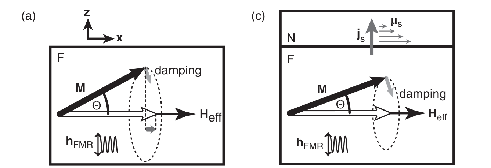
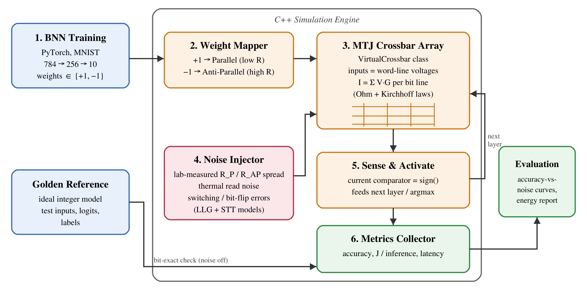

# Group 111

# Simulating an energy-efficient In-Memory Compute AI accelerator by mapping Binarized Neural Networks to Spintronic MTJ arrays

**Milestone 1 — First Report**

| | |
|---|---|
| **Group Number** | **111** |
| **Team Members** | Maya Zelkowicz (maya.zelkowicz@mail.huji.ac.il) Sarit Mishiev (sarit.mishiev@mail.huji.ac.il) |
| **Mentor** | Daniella (daniellah@gmail.com) |
| **Advisor** | Dr. Amir Capua (amir.capua@mail.huji.ac.il) |
| **Organization** | HUJI Spintronics Lab, The Hebrew University of Jerusalem |
| **Git Repository** | https://github.com/mayazelkowicz-source/Spintronics_Simulator |
| **Notion Workspace** | https://app.notion.com/p/Spintronics-Lab-Simulating-an-energy-efficient-In-Memory-Compute-AI-accelerator-ce5240c4d77d83e7a51d818497730381 |

## 1. Problem Definition

Running Artificial Intelligence (AI) on battery-powered edge devices is limited by the "Von Neumann bottleneck": moving data between memory and processor dominates energy and latency. Spintronic memories built from Magnetic Tunnel Junctions (MTJs) can compute inside memory, but thermal noise and switching errors may corrupt results. Chip architects and device physicists lack a fast way to predict this impact.

**Can AI inference stay accurate on noisy magnetic memory?**

## 2. Background and Related Work

**Background.** *Spintronics* exploits the electron's spin, not only its charge. Its key device, the **Magnetic Tunnel Junction (MTJ)**, is a nanoscale sandwich of two ferromagnetic layers separated by a thin insulator. One layer's magnetization is fixed; the other ("free layer") can flip. When both point the same way (Parallel, P) resistance is low; when opposite (Anti-Parallel, AP) it is high — the Tunnel Magnetoresistance (TMR) effect [1]. The free layer's motion obeys the **Landau–Lifshitz–Gilbert (LLG)** equation: magnetization precesses around the effective field and is damped back toward it [2]. A spin-polarized current exerts **Spin-Transfer Torque (STT)**, which opposes damping and can switch the bit electrically [3]. Thermal fluctuations make switching probabilistic.

A **Binarized Neural Network (BNN)** restricts weights and activations to ±1, turning multiplications into sign agreements — a natural fit for two-state MTJs.

**Related work.**
- **BNN / XNOR-Net** [4, 5] showed ±1 networks preserve much of full-precision accuracy at a fraction of the compute cost; they assume ideal digital hardware.
- **Samsung MRAM crossbar** [6] demonstrated the first MTJ-based in-memory computing array (64×64). Because MTJs have low resistance, the authors summed *resistances* instead of currents, achieving handwritten-digit classification on real silicon. Fabrication-level work is costly and hard to explore.
- **NeuroSim** [7] and **IBM AIHWKit** [8] simulate analog crossbars with generic, mostly resistive-RAM/phase-change device statistics, not magnetization dynamics.

**Our position.** Algorithmic works ignore physics; fabrication works cannot sweep design space; generic simulators lack spintronic physics. **We bridge this gap by injecting physically grounded thermal noise and switching errors — derived from LLG/STT models and HUJI Spintronics Lab measurements — into a fast, BNN-specific software simulator.**

**References**

1. S. Yuasa *et al.*, "Giant room-temperature magnetoresistance in single-crystal Fe/MgO/Fe magnetic tunnel junctions," *Nature Materials* 3, 868 (2004). https://doi.org/10.1038/nmat1257
2. M. Althammer *et al.*, "Spin Pumping," ch. 6 in K. Sato & E. Saitoh (eds.), *Spintronics for Next Generation Innovative Devices*, Wiley (2015). https://doi.org/10.1002/9781118751886
3. D. C. Ralph & M. D. Stiles, "Spin transfer torques," *J. Magn. Magn. Mater.* 320, 1190 (2008). https://doi.org/10.1016/j.jmmm.2007.12.019
4. M. Courbariaux, I. Hubara *et al.*, "Binarized Neural Networks," arXiv:1602.02830 (2016). https://arxiv.org/abs/1602.02830
5. M. Rastegari *et al.*, "XNOR-Net: ImageNet Classification Using Binary Convolutional Neural Networks," ECCV (2016). https://arxiv.org/abs/1603.05279
6. S. Jung *et al.* (Samsung), "A crossbar array of magnetoresistive memory devices for in-memory computing," *Nature* 601, 211 (2022). https://doi.org/10.1038/s41586-021-04196-6
7. P.-Y. Chen, X. Peng, S. Yu, "NeuroSim: A Circuit-Level Macro Model for Benchmarking Neuro-Inspired Architectures in Online Learning," *IEEE TCAD* 37(12), 3067 (2018). https://doi.org/10.1109/TCAD.2018.2789723
8. M. J. Rasch *et al.*, "A Flexible and Fast PyTorch Toolkit for Simulating Training and Inference on Analog Crossbar Arrays," IEEE AICAS (2021). https://arxiv.org/abs/2104.02184 — code: https://github.com/IBM/aihwkit
9. M. Horowitz, "Computing's energy problem (and what we can do about it)," IEEE ISSCC (2014). https://doi.org/10.1109/ISSCC.2014.6757323
10. M. Hu *et al.*, "Dot-Product Engine for Neuromorphic Computing," DAC (2016). https://doi.org/10.1145/2897937.2898010

## 3. Proposed Solution

### Overview — alternative approaches

**Abstract view.** Every approach answers: *given a trained BNN stored in MTJs, how much accuracy survives realistic device physics, and at what energy cost?* An MTJ is simply a nanoscale magnetic switch whose resistance stores one bit; in a grid (crossbar), currents add along each column, computing a weighted sum for free.

| | **Alt. 1: Hardware fabrication** | **Alt. 2: Transistor-level circuit simulation (SPICE)** | **Alt. 3: Hardware-aware architectural simulator (chosen)** |
|---|---|---|---|
| Idea | Fabricate and measure a physical MTJ crossbar | Model every MTJ and wire as a circuit element | Behavioral MTJ arrays with physics-derived statistical noise |
| Pros | Ground truth | Electrically precise | Fast; sweeps thousands of noise scenarios |
| Cons | Months per iteration; costly | Hours per inference for 200,000+ devices | Depends on model calibration |

### Solution proposal

We choose **Alternative 3**: our question is statistical (accuracy across many noise levels and seeds), requiring thousands of full-network inferences — feasible only architecturally. Calibration risk is mitigated by measured parameters from the HUJI Spintronics Lab and comparison with published circuit-level results [10].

### Key components

*Figure 1 – Magnetization dynamics described by the LLG equation (from the course reading, Althammer et al. [2], Fig. 6.1a,c).*

Figure 1 underpins our Noise Injector. In (a), the free-layer magnetization **M** precesses around the effective field while damping restores equilibrium — the stable P/AP states storing ±1 weights. In (c), angular momentum flows to a neighboring layer; its reciprocal, STT, *writes* weights, while thermal agitation causes unintended flips.

*Figure 2 – Component diagram of the proposed simulator.*

1. **BNN Training:** produces ±1 weights and golden test vectors.
2. **Weight Mapper:** +1 → P (low resistance), −1 → AP (high resistance).
3. **MTJ Crossbar Array (C++ `VirtualCrossbar`):** binarized pixels become word-line voltages; each bit line sums currents.
4. **Noise Injector:** adds device-to-device resistance variation, thermal read noise, and bit flips with probabilities from thermal-stability and STT switching statistics.
5. **Sense & Activate:** comparator implements sign(); outputs drive the next layer.
6. **Metrics Collector:** accuracy, Joules per inference, latency.

### Solution feasibility

- **Phase 1 is complete:** our PyTorch BNN (784→256→10) reaches **94.30%** MNIST test accuracy, proving algorithmic feasibility.
- **The C++ core exists:** `VirtualCrossbar` ideal inference is **bit-exact** with the golden reference on 100 test vectors (96/100 classified correctly).

### Technologies

- **C++17 / CMake** – high-performance simulation engine.
- **PyTorch** (https://pytorch.org) – BNN training.
- **Git / GitHub** – version control.
- **Notion** – planning and tracking.

### Challenges and uncertainties

- **IR drop** (voltage loss along resistive wires) distorts column currents in large arrays [10], worsened by MTJs' low resistance [6]. *Backup:* split layers into 64×64 tiles (as in [6]) with a first-order analytical attenuation model.
- **Read disturb:** read current exerts STT and may flip cells. *Backup:* model a per-read flip probability bounded by read-current limits.
- **Lab data availability.** *Backup:* use published MTJ parameters [1, 3].

### Required knowledge

- **Literature:** Cullity, *Introduction to Magnetic Materials*; Gurevich & Melkov, *Magnetization Oscillations and Waves*; Fabian, Žutić *et al.*, *Semiconductor Spintronics*; [2, 3]; Sze *et al.*, "Efficient Processing of Deep Neural Networks" (*Proc. IEEE*, 2017).
- **Courses:** Dr. Capua's Spintronics reading course (LLG dynamics, spin currents, STT); Computer Architecture; Machine Learning; MIT 6.5930 *Hardware Architecture for Deep Learning* (online).

## 4. Evaluation and Verification Scheme

**Persona.** A device researcher at the HUJI Spintronics Lab asking: *"Is our measured MTJ stack good enough for AI inference, and which parameter must improve?"*

**Verification (correctness).**
- Noise disabled: logits must be **bit-exact (100%)** with the golden reference on the full **10,000-image** MNIST test set (already achieved on 100 images).
- Unit tests for each physical model against analytical limits (e.g., zero temperature ⇒ zero flips).

**Evaluation (quantitative targets).**
- **Robustness:** accuracy drop **< 5 percentage points** versus the ideal BNN under lab-calibrated noise.
- **Sensitivity sweeps:** bit-error rate 0–10%, resistance variation 0–20%; each point averaged over **≥ 30 random seeds**, reported with 95% confidence intervals.
- **Energy:** Joules per inference from cell read energy (V²·G·t) plus sensing overhead, benchmarked against a Von Neumann baseline built from published per-operation and memory-access energies [9]; target **≥ 10× lower** energy.
- **Latency:** crossbar read cycles per inference versus sequential multiply-accumulate operations.
- **Simulator speed:** full test set in **< 60 seconds** on a laptop.

**Real-world testing.** Calibrate the Noise Injector with measured lab parameters (resistance spread, damping from ferromagnetic-resonance linewidths) and test generalization on degraded "in-the-wild" inputs (noisy, rotated digits; Fashion-MNIST).

## 5. Annual Work Plan

**First steps (November–December 2026):**
- Extend golden-reference verification to all 10,000 test images.
- Implement MTJ resistance mapping and current-based column summation.
- Collect device parameters from the Spintronics Lab.

**MVP — "Skateboard" (Demo Day, January 2027):** Our existing C++ core integrated with an MTJ conductance model and a statistical bit-flip Noise Injector, producing a live accuracy-versus-noise curve for the full MNIST BNN.

**"Bike" (March–April 2027):**
- Physics-derived noise: thermal stability, STT switching probability, read disturb.
- Energy and latency models; tiling with IR-drop approximation.

**"Car" (May–June 2027):**
- Lab-calibrated device-requirement map.
- Larger networks/datasets (Fashion-MNIST).
- Comparison with NeuroSim.
- Optional noise-aware retraining.

**Responsibilities:** Maya Zelkowicz leads physical/noise modeling and machine learning; Sarit Mishiev leads C++ engine architecture and optimization; evaluation is joint.

## 6. Project Management

- **Notion** (https://app.notion.com/p/Spintronics-Lab-Simulating-an-energy-efficient-In-Memory-Compute-AI-accelerator-ce5240c4d77d83e7a51d818497730381): project timeline, task assignments per member, requirement tracking, and weekly progress updates.
- **Git** (https://github.com/mayazelkowicz-source/Spintronics_Simulator): all code is versioned on GitHub. Each member commits their own work with descriptive messages, and a README documents build and run instructions. The verification suite runs before every merge to `main`.
