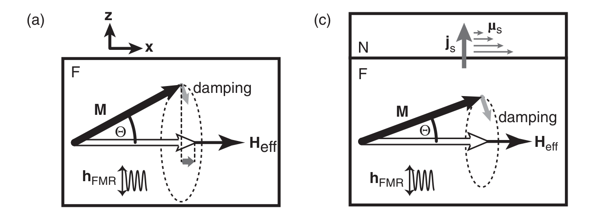
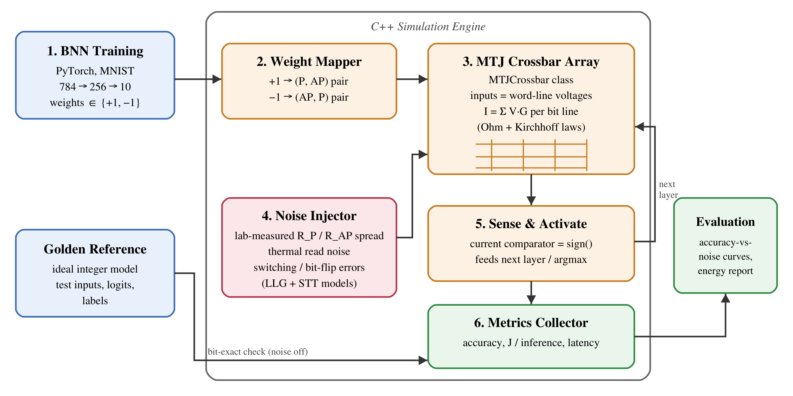

# Group 111

# Simulating an energy-efficient In-Memory Compute AI accelerator by mapping Binarized Neural Networks to Spintronic MTJ arrays

**Milestone 1: First Report**

| | |
|---|---|
| **Group Number** | **111** |
| **Team Members** | Maya Zelkowicz (maya.zelkowicz@mail.huji.ac.il) Sarit Mishiev (sarit.mishiev@mail.huji.ac.il) |
| **Mentor** | Daniella Har Shalom (daniellah@gmail.com) |
| **Advisor** | Dr. Amir Capua (amir.capua@mail.huji.ac.il) |
| **Organization** | HUJI Spintronics Lab, The Hebrew University of Jerusalem |
| **Git Repository** | https://github.com/mayazelkowicz-source/Spintronics_Simulator |
| **Notion Workspace** | https://app.notion.com/p/Spintronics-Lab-Simulating-an-energy-efficient-In-Memory-Compute-AI-accelerator-ce5240c4d77d83e7a51d818497730381 |

## 1. Problem Definition

Running Artificial Intelligence (AI) on battery-powered edge devices is limited by the "Von Neumann bottleneck": moving data between memory and processor dominates energy and latency. Spintronic memories built from Magnetic Tunnel Junctions (MTJs) can compute inside memory, but thermal noise and switching errors may corrupt results. Chip architects and device physicists lack a fast way to predict this impact.

**Can AI inference stay accurate on noisy magnetic memory?**

## 2. Background and Related Work

**Background.** *Spintronics* uses the electron's spin as well as its charge. Its key device, the **Magnetic Tunnel Junction (MTJ)**, places a thin insulator between two ferromagnetic layers: one fixed and one free to flip. Parallel (P) magnetizations give low resistance, Anti-Parallel (AP) high resistance (Tunnel Magnetoresistance) [1]. The free layer follows the **Landau–Lifshitz–Gilbert (LLG)** equation: the magnetization precesses around the effective field and is damped toward it [2]. A spin-polarized current exerts **Spin-Transfer Torque (STT)**, which opposes damping and can switch the bit [3]; thermal fluctuations make this probabilistic. A **Binarized Neural Network (BNN)** restricts weights and activations to ±1, matching the two stable MTJ states (resistance ratio 2.5 to 2.8 [1, 7]). One bit per device gives the widest sense margin, and a comparator replaces the analog-to-digital converters (ADCs) that use 58% of an analog accelerator's tile power [12].

**Related work.**
- **BinaryNet and XNOR-Net** [4, 5] showed ±1 networks keep most of full-precision accuracy with far less computation, on ideal digital hardware.
- **Samsung MRAM (Magnetoresistive Random-Access Memory) crossbar** [6]: a 64×64 MTJ array classified handwritten digits with 93.23% accuracy (software baseline: 95.24%). MTJ resistance is low, so they summed resistances instead of currents.
- **Hirtzlin et al.** [7] injected weight errors into BNNs; bit-error rates up to 0.1% had little effect. A switching model linked write errors to programming energy, halving it without error correction. Reads were error-free.
- **NeuroSim** [8] and **IBM AIHWKit** [9] simulate analog crossbars, mainly resistive and phase-change memories.

**Our contribution.** Unlike [7], we model the analog read: bit-line currents with resistance variation, read noise, read disturb and comparator margin, which matters because 2% of our hidden sums are exactly zero. Error rates come from LLG/STT models with lab or published parameters; joint accuracy, energy and latency sweeps show which device parameter must improve.

## 3. Proposed Solution

### Overview

**Abstract view.** In a crossbar of MTJs, inputs drive row wires (*word lines*) and each column wire (*bit line*) sums the currents, computing a weighted sum in memory.

| | **Alt. 1: Fabricate hardware** | **Alt. 2: Circuit simulation (SPICE, Simulation Program with Integrated Circuit Emphasis)** | **Alt. 3: Architectural simulator (chosen)** |
|---|---|---|---|
| Idea | Build and measure a real MTJ array | Model every device and wire electrically | Behavioral arrays with statistical noise |
| Pros | Real measurements | Electrically precise | Fast; wide parameter sweeps |
| Cons | Slow, costly fabrication | Slow for our ~400,000 MTJs | Depends on calibration |

### Solution proposal

We choose **Alternative 3**: each point of a noise-parameter sweep needs inference on the full 10,000-image test set over many seeds, practical only with a fast behavioral model. Lab measurements and published circuit-level results [10] reduce calibration risk.

### Key components

*Figure 1 – Magnetization dynamics described by the LLG equation (from the course reading, Althammer et al. [2], Fig. 6.1a,c).*

In Figure 1(a) the free layer is damped into a stable P or AP state; (c) shows angular-momentum transfer, whose reciprocal (STT) writes weights. Thermal agitation can flip them.

*Figure 2 – Component diagram of the proposed simulator.*

1. **BNN Training:** ±1 weights and *golden reference* data (trusted inputs, outputs, labels).
2. **Weight Mapper:** stores each weight in two MTJs on paired bit lines: +1 as (P, AP), −1 as (AP, P). Subtracting the two currents cancels the input-dependent offset, leaving the signed sum.
3. **MTJ Crossbar (C++ `MTJCrossbar`):** inputs drive word lines; bit lines sum currents.
4. **Noise Injector:** resistance variation, read noise, physics-based bit flips.
5. **Sense & Activate:** sign() between layers; argmax over the ten outputs gives the predicted digit.
6. **Metrics Collector:** accuracy, energy, latency.

### Solution feasibility

- **Algorithm:** our PyTorch BNN (784-256-10) reaches **94.30%** test accuracy on MNIST (Modified National Institute of Standards and Technology handwritten digits). In our full-precision runs the same topology reaches 98.20 ± 0.11% over 3 seeds, and a larger batch-normalized BNN 99.04% [4]. Our BNN with learned per-neuron thresholds reaches only 94.56 ± 0.13%, so most of the gap comes from binarization, as expected for a fully binarized network of this size.
- **Simulator core:** C++ ideal inference reproduces the golden *logits* (raw per-class scores) exactly on all 10,000 test images; the MTJ conductance model predicts the same classes.
- **Noise Injector (implemented):** seeded resistance-variation and bit-flip models behind a common interface, with unit tests.

### Technologies and skills

- **C++17, CMake** (https://cmake.org): simulation engine. *Skills:* efficient C++, Monte Carlo simulation.
- **PyTorch** (https://pytorch.org): BNN training. *Skills:* quantization-aware training.
- **Git, GitHub** (https://github.com): version control. *Skills:* branching, code review.
- **Hardware knowledge:** MTJ physics, crossbar circuits, sense amplifiers, energy estimation.

### Challenges and uncertainties

- **IR drop** (I·R voltage loss along wires) distorts bit-line currents [10], worse with low MTJ resistance [6]. *Backup:* 64×64 tiles with first-order attenuation, or resistance summation [6].
- **Read disturb:** read current exerts STT and may flip cells. *Backup:* per-read flip probability.
- **Lab data availability.** *Backup:* published parameters [1, 3, 7].

### Required knowledge

- **Literature:** Cullity (magnetic materials); Gurevich and Melkov (magnetization dynamics); Fabian, Žutić et al. (spin transport); [2, 3, 7]; Sze et al. (2017).
- **Courses:** Dr. Amir Capua's Spintronics reading course (LLG dynamics, spin currents, STT); Computer Architecture; Machine Learning; MIT 6.5930 *Hardware Architecture for Deep Learning* (online).

## 4. Evaluation and Verification Scheme

**Persona.** A device researcher at the HUJI Spintronics Lab asking: *"Is our measured MTJ stack good enough for AI inference, and which parameter must improve?"*

**Verification.**
- With noise disabled, the integer model matches the golden logits exactly and the conductance model predicts the same class on all **10,000** test images (both achieved).
- Unit tests check each physical model against analytical limits (zero temperature gives zero flips).

**Evaluation (quantitative targets).**
- **Robustness:** per noise source, the largest level keeping the accuracy drop below 1, 2 and 5 percentage points; target **at most 2 points** with lab or published parameters, as measured in [6].
- **Sensitivity sweeps:** bit-error rate 0–10% and resistance variation 0–20%; **at least 30 seeds** per point, with 95% confidence intervals.
- **Energy:** Joules per inference, measured, not preset: cell reads (voltage² × conductance × time), drivers and per-column comparators (no ADC), versus a digital processor using XNOR and bit-count logic, reading 203,264 weights from on-chip static random-access memory [11]; programming excluded.
- **Latency:** crossbar read cycles versus sequential multiply-accumulate operations.
- **Simulator speed:** full test set in **under 60 seconds** on a laptop.

**Real-world testing.** Lab-measured resistance spread and damping will calibrate the Noise Injector; noisy, rotated digits and Fashion-MNIST test robustness.

## 5. Annual Work Plan

**First steps, November–December 2026 (essential):**
- Golden-reference verification on all 10,000 test images (done).
- MTJ resistance mapping and bit-line current summation (done).
- Collecting device parameters from the Spintronics Lab.

**MVP (Minimum Viable Product), "Skateboard", Demo Day January 2027 (essential):** our existing C++ core extended with an MTJ conductance model and a statistical bit-flip Noise Injector (both implemented), producing an accuracy-versus-noise curve for the MNIST BNN.

**"Bike", March–April 2027 (essential):**
- Physics-derived noise: thermal stability, STT switching probability, read disturb.
- Energy and latency models.
- *Nice-to-have:* tiling with an IR-drop approximation; comparison of current and resistance summation, possibly through an in-depth study of the Samsung 64×64 array [6] (readout circuit, sources of its 2-point accuracy loss) and an exploration of whether a modified architecture could reduce that loss.

**"Car", May–June 2027:**
- *Essential:* final evaluation against the targets in Section 4; basic device-requirement map from lab or published parameters.
- *Nice-to-have:* lab-calibrated device-requirement map; Fashion-MNIST; comparison with NeuroSim; noise-aware retraining; multi-bit weights split over several MTJs.

**Responsibilities:** Maya Zelkowicz leads physical and noise modeling and machine learning; Sarit Mishiev leads C++ engine architecture and optimization; evaluation is joint.

## 6. Project Management

- **Notion** (https://app.notion.com/p/Spintronics-Lab-Simulating-an-energy-efficient-In-Memory-Compute-AI-accelerator-ce5240c4d77d83e7a51d818497730381): project timeline, task assignments per member, requirement tracking and weekly progress updates.
- **Git** (https://github.com/mayazelkowicz-source/Spintronics_Simulator): all code is versioned on GitHub. Each member commits their own work with descriptive messages, and the README documents setup and run instructions. Regression testing is manual: before pushing, we run the C++ test and confirm exact agreement with the golden reference.

## References

1. S. Yuasa et al., "Giant room-temperature magnetoresistance in single-crystal Fe/MgO/Fe magnetic tunnel junctions," *Nature Materials* 3, 868 (2004). https://doi.org/10.1038/nmat1257
2. M. Althammer et al., "Spin Pumping," in K. Sato and E. Saitoh (eds.), *Spintronics for Next Generation Innovative Devices*, Wiley (2015). https://doi.org/10.1002/9781118751886
3. D. C. Ralph and M. D. Stiles, "Spin transfer torques," *Journal of Magnetism and Magnetic Materials* 320, 1190 (2008). https://doi.org/10.1016/j.jmmm.2007.12.019
4. M. Courbariaux, I. Hubara et al., "Binarized Neural Networks: Training Deep Neural Networks with Weights and Activations Constrained to +1 or -1," arXiv (2016). https://arxiv.org/abs/1602.02830
5. M. Rastegari et al., "XNOR-Net: ImageNet Classification Using Binary Convolutional Neural Networks," ECCV (2016). https://arxiv.org/abs/1603.05279
6. S. Jung et al., "A crossbar array of magnetoresistive memory devices for in-memory computing," *Nature* 601, 211 (2022). https://doi.org/10.1038/s41586-021-04196-6
7. T. Hirtzlin et al., "Implementing Binarized Neural Networks with Magnetoresistive RAM without Error Correction," IEEE/ACM NANOARCH (2019). https://arxiv.org/abs/1908.04085
8. P.-Y. Chen, X. Peng and S. Yu, "NeuroSim: A Circuit-Level Macro Model for Benchmarking Neuro-Inspired Architectures in Online Learning," *IEEE TCAD* 37(12), 3067 (2018). https://doi.org/10.1109/TCAD.2018.2789723
9. M. J. Rasch et al., "A Flexible and Fast PyTorch Toolkit for Simulating Training and Inference on Analog Crossbar Arrays," IEEE AICAS (2021). https://arxiv.org/abs/2104.02184
10. M. Hu et al., "Dot-Product Engine for Neuromorphic Computing: Programming 1T1M Crossbar to Accelerate Matrix-Vector Multiplication," DAC (2016). https://doi.org/10.1145/2897937.2898010
11. M. Horowitz, "Computing's energy problem (and what we can do about it)," IEEE ISSCC (2014). https://doi.org/10.1109/ISSCC.2014.6757323
12. A. Shafiee et al., "ISAAC: A Convolutional Neural Network Accelerator with In-Situ Analog Arithmetic in Crossbars," ACM/IEEE ISCA (2016). https://doi.org/10.1145/3007787.3001139
